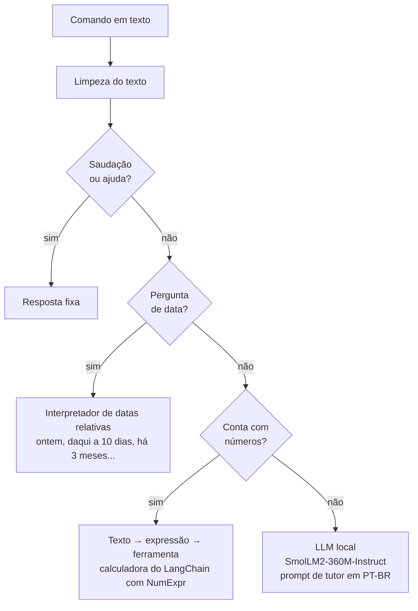

# Agente Inteligente com LangChain

Assistente de linha de comando em Python que entende comandos em português: resolve **contas** e **datas** com ferramentas próprias e responde perguntas abertas com uma **LLM local** do Hugging Face, sem depender de API paga.



## Como funciona

O agente decide o caminho de cada comando **por regras**, na ordem do diagrama, e só usa a LLM quando nenhuma ferramenta se aplica. Assim, contas e datas saem sempre corretas e instantâneas, e o modelo de linguagem fica para o que realmente precisa dele.

- **Datas relativas** (`interpretar_data_relativa`): hoje, ontem, anteontem, amanhã, depois de amanhã e "daqui a / há N dias, semanas, meses ou anos", com datas por extenso em português e tratamento de meses de tamanhos diferentes e anos bissextos.
- **Cálculos** (`normalizar_expressao` + ferramenta `calculadora`): converte linguagem natural em expressão matemática ("8 vezes 9", "20% de 500", "2 elevado a 10", "raiz quadrada de 144") e avalia com o NumExpr, sem `eval` do Python.
- **Perguntas abertas** (`responder_llm`): um prompt de **tutor acadêmico** (português, objetivo, admite quando não sabe) enviado ao modelo `HuggingFaceTB/SmolLM2-360M-Instruct`, que roda na própria máquina via `transformers` e LangChain.

## Exemplos

```
Você: Quanto é 8 vezes 9?
Agente: Resultado: 72

Você: Daqui a 10 dias que data será?
Agente: Daqui a 10 dias será 19 de outubro de 2026

Você: Calcule 20% de 500
Agente: Resultado: 100.0
```

O arquivo `exemplos_demo.txt` traz uma lista de comandos para testar cada caminho (saudações, ajuda, datas, cálculos e perguntas abertas).

## Como executar

Pré-requisitos: **Python 3.12** e cerca de 2 GB livres (PyTorch e o modelo, baixado automaticamente na primeira execução).

```bash
python -m venv venv
venv\Scripts\activate          # Windows
source venv/bin/activate       # Linux/macOS

# PyTorch só para CPU (evita baixar pacotes de GPU desnecessários)
pip install torch --index-url https://download.pytorch.org/whl/cpu
pip install -r requirements.txt

python app.py
```

Digite os comandos no terminal e `sair` para encerrar.

## Limitações

- O modelo de linguagem é **pequeno** (360 milhões de parâmetros), escolhido para rodar em qualquer computador sem GPU. Nas perguntas abertas, as respostas costumam ser **imprecisas ou pouco coerentes** em português. Contas e datas não passam pelo modelo e não têm esse problema.
- A escolha do caminho é feita por **palavras-chave**: frases como "há quanto tempo..." podem ser tratadas como pergunta de data, e qualquer número junto de "mais" ou "menos" é tratado como conta.

## Tecnologias

Python · LangChain (`langchain-core`, `langchain-huggingface`) · Hugging Face Transformers · PyTorch · NumExpr
